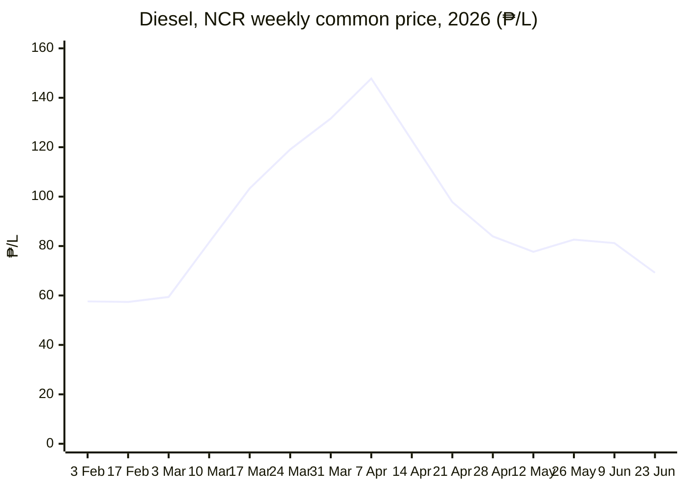
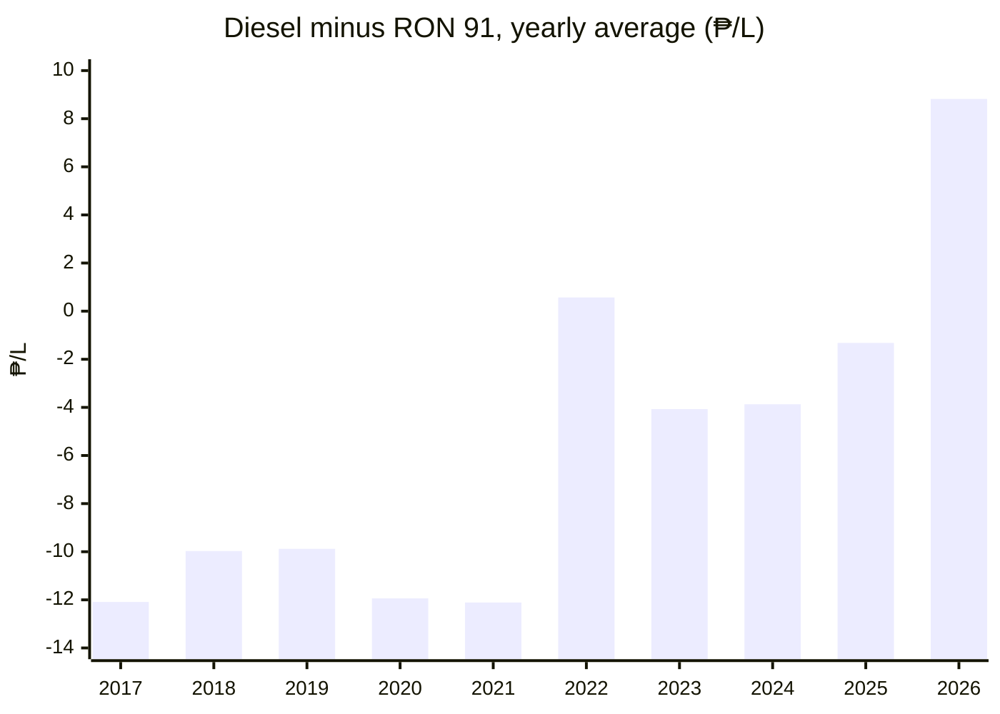
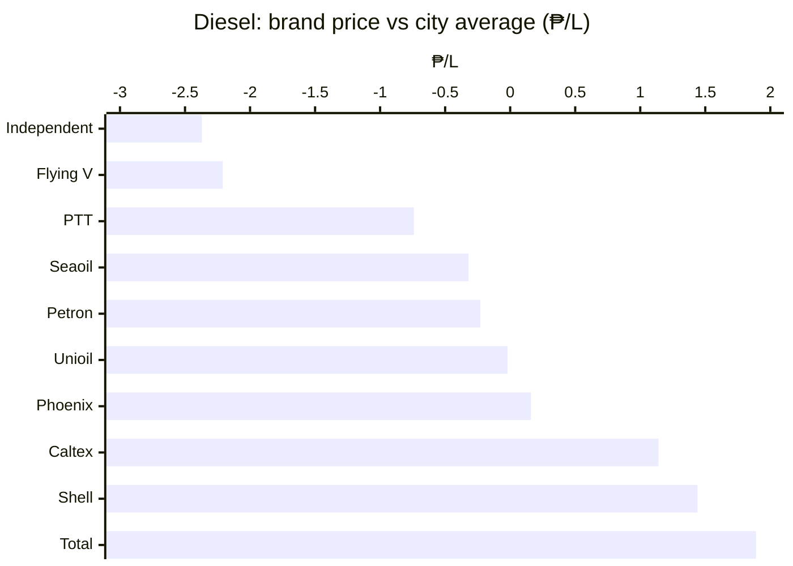
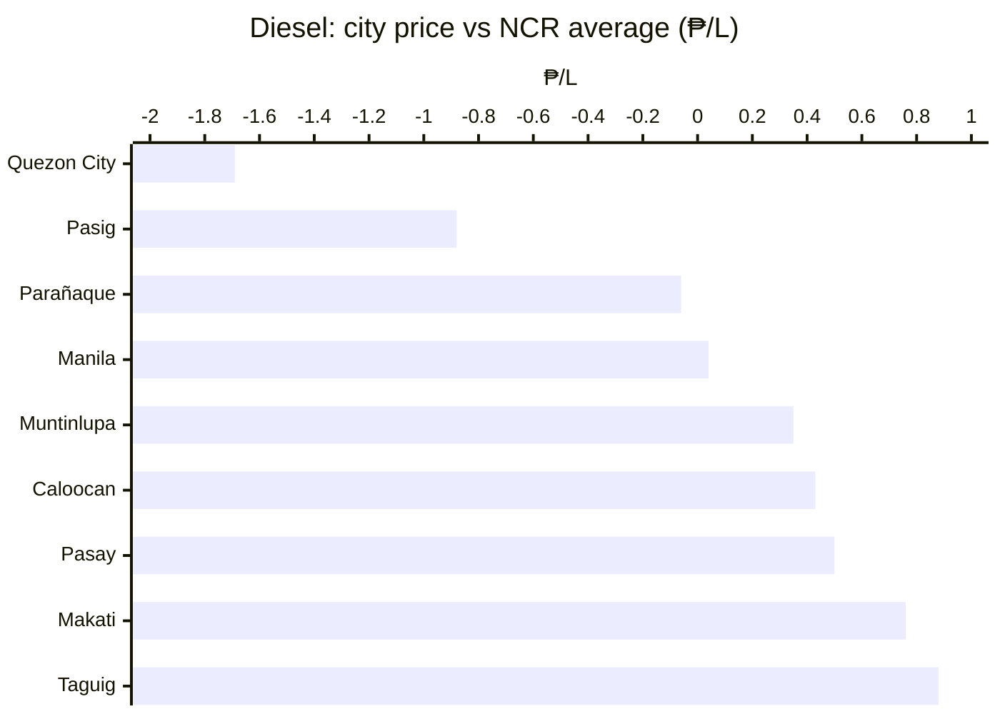
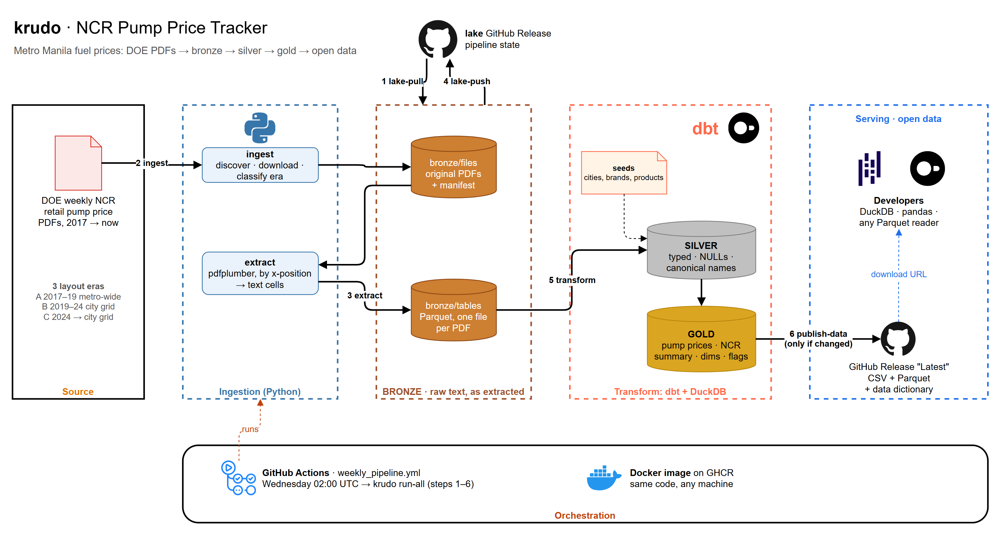

# krudo: Metro Manila pump prices as open data

[](https://github.com/OrcaDS/krudo/actions/workflows/ci.yml)
[](https://github.com/OrcaDS/krudo/actions/workflows/weekly_pipeline.yml)

The Department of Energy (DOE) checks retail fuel prices at Metro Manila (NCR) gas stations every week. It publishes the results only as PDFs, which have used three different layouts since 2017, and offers no API. krudo reads every one of those reports, close to 500 so far, and turns them into one clean table: **weekly pump prices by city, brand and product, January 2017 to now**, about 95,000 rows. A GitHub Action updates it every week, and it's free to download as Parquet or CSV.

**[Download the data](../../releases/latest)** · [Data dictionary](docs/data_dictionary.md)

## Findings

All numbers come from the [example queries](warehouse/queries/) on the gold tables (DOE's "common price", the price most stations charged, unless noted; flagged typos excluded). They run as-is on `lake/krudo.duckdb`, or on the release Parquet files after `CREATE VIEW fct_ncr_summary AS FROM '<url>'`.

### 1. Diesel went from ₱57 to ₱148 a litre in five weeks in 2026

Through February 2026 diesel sat at about ₱57/L across Metro Manila. From the 10 March adjustment it rose every week, peaking at ₱147.76 on 7 April, 2.6 times its February price, then fell back to about ₱70 by the end of June. ([`diesel_spike_2026.sql`](warehouse/queries/diesel_spike_2026.sql))



### 2. Diesel used to be ₱10–12 cheaper than gasoline. Not any more

From 2017 to 2021, diesel averaged ₱10–12 a litre less than RON 91 gasoline every year. The gap closed in 2022, shrank to ₱1.32 in 2025, and in 2026 diesel is ₱8.82 *dearer* on average. ([`diesel_vs_gasoline.sql`](warehouse/queries/diesel_vs_gasoline.sql))



### 3. Unbranded stations are about ₱2.40 cheaper; Total, Shell and Caltex charge more

Compared with the other brands in the same city and week, unbranded (`Independent`) stations and Flying V sold diesel about ₱2.20–2.40 a litre below average, while Total, Shell and Caltex sold it ₱1.10–1.90 above. That is roughly ₱170 between the cheapest and the dearest brand on a 40-litre tank. RON 91 shows the same order. ([`brand_gap.sql`](warehouse/queries/brand_gap.sql), city reports from June 2019)



### 4. Quezon City has the cheapest diesel, Taguig and Makati the dearest

Among the cities DOE has tracked for five years or more, Quezon City's common diesel price averaged ₱1.69 below the NCR average for the same week, and Pasig ₱0.88 below. Taguig (₱0.88 above) and Makati (₱0.76 above) were the most expensive. ([`city_gap.sql`](warehouse/queries/city_gap.sql))



## Quickstart

Every file has a fixed URL that always points to the latest release:

```
https://github.com/OrcaDS/krudo/releases/latest/download/<file>
```

With [DuckDB](https://duckdb.org/) (no download step needed; the first remote query installs DuckDB's `httpfs` extension, which takes a few seconds):

```sql
SELECT week_start, brand, price_low, price_high
FROM 'https://github.com/OrcaDS/krudo/releases/latest/download/fct_pump_prices.parquet'
WHERE city = 'Quezon City' AND product = 'Diesel'
ORDER BY week_start DESC, brand;
```

With pandas:

```python
import pandas as pd

url = "https://github.com/OrcaDS/krudo/releases/latest/download/fct_pump_prices.parquet"
df = pd.read_parquet(url)  # needs pyarrow
```

With curl:

```sh
curl -LO https://github.com/OrcaDS/krudo/releases/latest/download/krudo_gold_csv.zip
```

## What's in the release

| File | One row per | Contents |
|---|---|---|
| `fct_pump_prices.parquet` | week × city × brand × product | Each brand's lowest and highest price |
| `fct_ncr_summary.parquet` | week × city × product | DOE's overall low–high range and "common price" (the price most stations charged) |
| `dim_city.parquet`, `dim_brand.parquet`, `dim_product.parquet` | city, brand or product | Lookup tables; `dim_product` adds fuel family (gasoline, diesel, kerosene) and octane |
| `krudo_gold_csv.zip` | | The five tables above as CSV |
| `data_dictionary.md` | | Every column, explained |

Prices are pesos per litre. Products: RON 91, RON 95, RON 97, RON 100, Diesel, Diesel Plus, Kerosene. Brands: Petron, Shell, Caltex, Phoenix, Seaoil, Total, Unioil, Flying V, PTT, and `Independent` (unbranded stations).

`week_start` is always a Tuesday, the day DOE's weekly price adjustments take effect. An empty price means DOE printed no price for that cell. It never means zero.

The full schema is in the [data dictionary](docs/data_dictionary.md).

## Coverage and limitations

- **NCR only.** DOE also publishes other regions; krudo doesn't read them yet.
- **No cities before mid-2019.** From January 2017 to September 2019, DOE reported one table for all of Metro Manila. Those rows have `geo_level = 'metro'` and an empty `city`. City-level rows start in June 2019, so the two overlap for a few months. The set of cities DOE reports on changes over time (see the data dictionary).
- **Some weeks are missing.** DOE skipped some weeks, mostly holidays. Two reports (28 May 2019 and 21 Oct 2021) are scanned images with no readable text, so they're left out.
- **DOE's typos are kept, not corrected.** Rows where the low price is above the high price, or a price falls outside ₱20–₱200 (e.g. `3700`), are flagged with `is_low_above_high` and `is_out_of_bounds`. Filter them out if you don't need them.
- DOE's overall range and common price are copied exactly as printed. They don't always agree with the brand prices in the same report.
- Where DOE issued a revised report, only the newest version is used.
- The data comes from parsing PDFs, so it may contain extraction errors. If you find one, please [open an issue](../../issues).

## Attribution and license

**Source:** Department of Energy – Oil Industry Management Bureau, NCR price monitoring. Cleaned and standardized by krudo. This is not an official DOE product.

The data is Philippine government work, which has no copyright (RA 8293 §176). The code is [MIT](LICENSE). The data is provided as is, without warranty.

## How it works



A medallion pipeline, built the same way as its sister project [tawad](https://github.com/OrcaDS/tawad) (DA food prices):

- **Bronze** keeps every price cell's text exactly as it came out of the PDF, with its source file and page.
- **Silver** (dbt) types the values, turns every way DOE writes "no price" (`-`, `#N/A`, `NONE`, `NO LFRO`, blank) into NULL, and maps city, brand and product names onto canonical ones. If DOE uses a name krudo hasn't seen before, the build fails instead of letting it through unmapped.
- **Gold** is the fact and dimension tables listed above, with data tests on keys, relationships and price ranges.

The hard parts were the PDFs themselves. Report dates have to come from the title, because URLs and link text disagree with it. When a brand cell is blank, the other values shift left, so prices are matched to brands by their x-position under the header. DOE's bold text is printed twice, and city labels overlap. The details are in [`docs/parsing_notes.md`](docs/parsing_notes.md), and the original research is in [`docs/recon.md`](docs/recon.md).

Every Wednesday at 10:00 Philippine time, [`weekly_pipeline.yml`](.github/workflows/weekly_pipeline.yml) runs `krudo run-all` in the project's Docker image. It restores the lake (the project's stored data) from a GitHub prerelease, downloads new reports, extracts them, rebuilds gold, saves the lake back, and publishes a new release only if the data changed. If DOE's site is down, that week's download is skipped and the rest of the run continues.

GitHub turns off scheduled workflows in public repositories after 60 days without activity. If the data stops updating, re-enable the workflow under Actions.

## Run it yourself

With [uv](https://docs.astral.sh/uv/) and Python 3.11+:

```sh
uv sync
uv run pytest -q
uv run krudo lake-pull        # restore bronze from the lake release (needs gh auth)
uv run krudo transform        # dbt build: silver + gold into lake/krudo.duckdb
```

To start from scratch instead, run `uv run krudo ingest` (downloads every PDF, about 45 minutes, spaced 5 seconds apart to be polite to DOE's server), then `uv run krudo extract` and `uv run krudo transform`. Settings come from environment variables, which are listed in [`.env.example`](.env.example).
